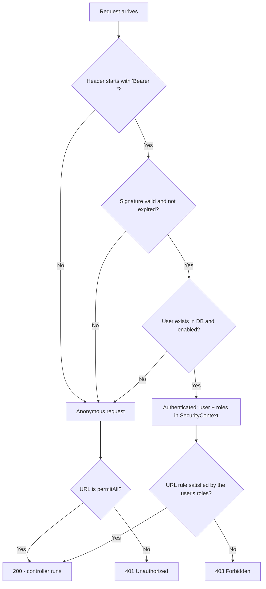
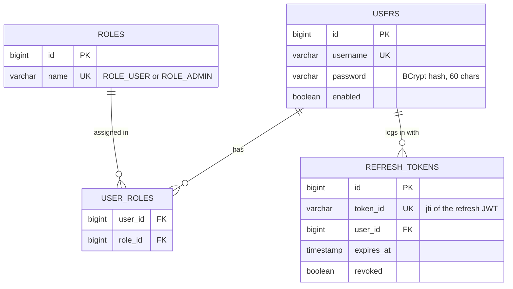

<div dir="rtl">

# אבטחת REST API עם Spring Security ו‑JWT

שרת Spring Boot שבו משתמש מתחבר עם שם וסיסמה, מקבל **JWT**, ומשתמש בו כדי לגשת לנקודות קצה מוגנות לפי תפקיד (ROLE).

**טכנולוגיות:** Java 21 · Spring Boot 4.1.1 · Spring Security · JPA/Hibernate · PostgreSQL 16 · jjwt 0.13.0 · Lombok

---

## אזורי האבטחה

| אזור | כתובות | מי נכנס |
|---|---|---|
| ציבורי | ‎`/api/auth/**`‎, ‎`/api/public/**`‎ | כולם, בלי טוקן |
| משתמש | ‎`/api/user/**`‎ | ‎`ROLE_USER`‎ |
| מנהל | ‎`/api/admin/**`‎ | ‎`ROLE_ADMIN`‎ |

- **401** – "אני לא יודע מי אתה" (אין טוקן / טוקן לא תקין או שפג).
- **403** – "אני יודע מי אתה, ואסור לך" (אין את התפקיד הנדרש).

## נקודות הקצה

| שיטה | כתובת | תיאור |
|---|---|---|
| POST | ‎`/api/auth/login`‎ | שם + סיסמה ← Access Token ‏(JWT) + Refresh Token |
| POST | ‎`/api/auth/refresh`‎ | ‏Refresh Token ← זוג טוקנים **חדש** (הישן מפסיק לעבוד) |
| POST | ‎`/api/auth/logout`‎ | מבטל את ה‑Refresh Token ‏(204) |
| POST | ‎`/api/auth/register`‎ | משתמש חדש, תמיד ‎`ROLE_USER`‎ בלבד (‏201) |
| GET | ‎`/api/public/hello`‎ | פתוח לכולם |
| GET | ‎`/api/user/me`‎ | פרטי המשתמש המחובר |
| GET | ‎`/api/admin/users`‎ | רשימת כל המשתמשים (מנהל בלבד) |

---

## איך זה עובד

**לוגין:**
1. הלקוח שולח שם וסיסמה ל‑‎`POST /api/auth/login`‎.
2. ‏`AuthenticationManager` טוען את המשתמש מה‑DB (דרך ‎`CustomUserDetailsService`‎) ומשווה את הסיסמה ל‑Hash של BCrypt.
3. אם נכון – השרת מחזיר שני טוקנים:
   - **Access Token** – ‏JWT חתום (HS256) עם ‎`"type": "access"`‎, תקף **15 דקות**. נשלח בכל בקשה.
   - **Refresh Token** – גם הוא JWT חתום, עם ‎`"type": "refresh"`‎ ומזהה ייחודי ‎`jti`‎, תקף **7 ימים**. משמש רק לקבלת Access Token חדש. ה‑‎`jti`‎ נשמר ב‑DB.

דוגמה ל‑Payload של Refresh Token (אין בו תפקידים – הוא לא נותן גישה לשום דבר):

</div>

```json
{ "sub": "user", "jti": "46533ec1-b314-4e57-966f-91f9884b7612", "type": "refresh", "iat": 1793004693, "exp": 1793609493 }
```

<div dir="rtl">

**רענון (Refresh):**
1. כשה‑Access Token פג, הלקוח שולח את ה‑Refresh Token ל‑‎`POST /api/auth/refresh`‎ – בלי סיסמה.
2. השרת בודק פעמיים:
   - **ה‑JWT:** חתימה, תוקף, ו‑‎`"type": "refresh"`‎ (Access Token שנשלח לכאן נדחה).
   - **ה‑DB:** ה‑‎`jti`‎ קיים ועוד לא שומש או בוטל.
3. אם הכול תקין – מחזיר **זוג טוקנים חדש**, וה‑Refresh Token הישן מסומן כמשומש (**Rotation**).
4. אם Refresh Token שכבר שומש חוזר שוב – כנראה שמישהו העתיק אותו. השרת מבטל **את כל** ה‑Refresh Tokens של המשתמש, וצריך להתחבר מחדש.

**יציאה (Logout):** ‏‎`POST /api/auth/logout`‎ מבטל את ה‑Refresh Token. ה‑Access Token ממשיך לעבוד עד שיפוג – ‏JWT אי אפשר לבטל, ולכן הוא קצר.

**בקשה מוגנת:**
1. הלקוח שולח ‎`Authorization: Bearer <token>`‎.
2. ‏`JwtAuthFilter` בודק חתימה ותוקף, טוען את המשתמש **העדכני** מה‑DB ושם אותו ואת התפקידים ב‑‎`SecurityContext`‎.
3. ‏`SecurityConfig` מחליט לפי הכתובת והתפקידים: 200, ‏401 או 403.

</div>



<div dir="rtl">

---

## מבנה הקוד

</div>

```text
src/main/java/com/example/jwtlesson/
├── JwtLessonApplication.java      נקודת הכניסה
├── entity/
│   ├── User.java                  טבלת users (הצד הבעלים של רבים-לרבים)
│   ├── Role.java                  טבלת roles (הצד ההפוך, mappedBy)
│   ├── RoleName.java              enum: ROLE_USER, ROLE_ADMIN
│   └── RefreshToken.java          טבלת refresh_tokens: jti של הטוקן, משתמש, תוקף, בוטל?
├── repository/
│   ├── UserRepository.java        findByUsername + @EntityGraph לטעינת התפקידים
│   ├── RoleRepository.java        findByName
│   └── RefreshTokenRepository.java  findByTokenId (jti) + ביטול כל הטוקנים של משתמש
├── dto/                           מה נכנס ויוצא מה-API (records)
│   ├── LoginRequest.java
│   ├── RegisterRequest.java       בלי שדה roles – הלקוח לא בוחר תפקיד
│   ├── RefreshRequest.java        גוף הבקשה של refresh ו-logout
│   ├── LoginResponse.java         Access Token + Refresh Token + תפקידים
│   └── UserResponse.java          בלי סיסמה, תפקידים כמחרוזות
├── security/
│   ├── CustomUserDetailsService.java  טוען משתמש מה-DB עבור Spring Security
│   ├── JwtUtil.java               יצירה ואימות של טוקן
│   └── JwtAuthFilter.java         בודק את הטוקן בכל בקשה
├── config/
│   ├── SecurityConfig.java        כל חוקי האבטחה במקום אחד
│   └── DataInitializer.java       יוצר תפקידים + admin/user בעלייה, אם חסרים
├── service/
│   ├── UserLoginService.java      לוגין, הרשמה, רענון ויציאה
│   ├── RefreshTokenService.java   יצירה, בדיקה וביטול של Refresh Tokens
│   └── UserService.java           שליפת משתמשים והמרה ל-DTO
├── controller/
│   ├── UserLoginController.java   /api/auth/login, register, refresh, logout
│   └── ResourceController.java    נקודת קצה אחת לכל אזור אבטחה
└── exception/
    ├── GlobalExceptionHandler.java   Exceptions -> JSON (401 / 409 / 400)
    ├── UsernameTakenException.java
    └── InvalidRefreshTokenException.java
```

<div dir="rtl">

## מודל הנתונים

משתמש יכול להחזיק כמה תפקידים, ותפקיד שייך לכמה משתמשים – יחס **רבים לרבים** דרך טבלת הקישור ‎`user_roles`‎.

</div>



<div dir="rtl">

---

## החלטות חשובות בקוד

| החלטה | למה |
|---|---|
| ‎`@Table(name = "users")`‎ | ‏‎`user`‎ היא מילה שמורה ב‑PostgreSQL |
| סיסמה נשמרת כ‑Hash של **BCrypt** | חד‑כיווני, עם Salt אקראי ואיטי בכוונה. בלוגין משווים ‎`matches(raw, hash)`‎ |
| התפקידים נקראים ‎`ROLE_ADMIN`‎ ו‑‎`ROLE_USER`‎ | ‏‎`hasRole("ADMIN")`‎ מחפש בפועל ‎`ROLE_ADMIN`‎ |
| בלי ‎`@Data`‎ על Entities | ‏‎`hashCode`‎/‎`toString`‎ על יחס דו‑כיווני ← ‎`StackOverflowError`‎ |
| ה‑API מחזיר **DTO** בלבד, לא Entity | בלי סיסמה בתשובה, בלי לולאה אינסופית ב‑JSON |
| ‎`@EntityGraph(attributePaths = "roles")`‎ | טוען תפקידים באותה שאילתה – בלי ‎`LazyInitializationException`‎ ובלי N+1 |
| ‏Stateless + ‎`csrf.disable()`‎ | אין Session ואין Cookies – הטוקן נשלח בכותרת |
| ‏`JwtAuthFilter` **לא** ‎`@Component`‎ | אחרת Spring Boot היה רושם אותו פעמיים |
| ה‑Filter טוען את המשתמש מה‑DB בכל בקשה | משתמש שנחסם או ששונה לו תפקיד – השינוי תקף מיד |
| ‎`authenticationEntryPoint`‎ מוגדר במפורש | בלעדיו Spring מחזיר 403 גם כשאין טוקן, במקום 401 |
| אותה הודעת שגיאה לסיסמה שגויה ולמשתמש לא קיים | לא לגלות לתוקף אילו שמות משתמש קיימים |
| Access Token קצר (15 דק') + Refresh Token ארוך (7 ימים) | ‏JWT אי אפשר לבטל – אז מגבילים את הזמן שטוקן גנוב שווה משהו, בלי להכריח התחברות כל רבע שעה |
| ה‑Refresh Token הוא JWT, **וגם** ה‑‎`jti`‎ שלו נשמר ב‑DB | ‏JWT לבד אי אפשר לבטל – טוקן גנוב היה עובד 7 ימים. השורה ב‑DB מאפשרת Logout ושימוש חד‑פעמי |
| claim ‏‎`type`‎ ‏(‎`access`‎ / ‎`refresh`‎) | שני הטוקנים חתומים באותו סוד – בלי ‎`type`‎ אפשר היה לשלוח Refresh Token כ‑Bearer (או להפך) |
| ב‑Refresh Token אין תפקידים | הוא לא נותן גישה לשום דבר – רק מאפשר לקבל Access Token חדש |
| ‏Rotation – כל Refresh Token עובד פעם אחת | טוקן שחוזר שוב = גניבה. השרת מבטל את כל הטוקנים של המשתמש |

> ה‑Payload של JWT **לא מוצפן** – רק חתום. כל אחד יכול לקרוא אותו, ולכן לא שמים בו מידע רגיש.

---

## הרצה

**1. מסד נתונים (Docker):**

</div>

```bash
docker run --name pg-lesson -e POSTGRES_PASSWORD=postgres -e POSTGRES_DB=jwt_lesson -p 5432:5432 -d postgres:16
```

<div dir="rtl">

בפעמים הבאות: ‎`docker start pg-lesson`‎. את הטבלאות Hibernate יוצר לבד (‎`ddl-auto=update`‎).

**2. השרת:** ב‑IntelliJ מריצים את ‎`JwtLessonApplication`‎ (פורט 8080).

**3. משתמשים ראשוניים** (נוצרים ע"י ‎`DataInitializer`‎):

| משתמש | סיסמה | תפקידים |
|---|---|---|
| ‎`admin`‎ | ‎`Admin123!`‎ | ‏ROLE_ADMIN, ROLE_USER |
| ‎`user`‎ | ‎`User123!`‎ | ‏ROLE_USER |

**4. בדיקות:** פותחים את ‎`http/security-tests.http`‎ ב‑IntelliJ, בוחרים סביבה **dev** ומריצים **Run All Requests in File**. ‏32 בדיקות – לוגין, 401/403, טוקן מזויף, הרשמה, ו‑Refresh Token (רענון, שימוש חוזר, Logout, בלבול בין סוגי הטוקנים).

> הסוד של ה‑JWT והסיסמאות ב‑‎`application.properties`‎ הם ברירות מחדל לשיעור בלבד. בייצור מגדירים אותם במשתני סביבה (‎`JWT_SECRET`‎, ‎`DB_PASSWORD`‎, ‎`ADMIN_PASSWORD`‎, ‎`USER_PASSWORD`‎).

</div>
